<table>
  <tr>
    <!-- add assets/meme.gif, then uncomment: the card re-sizes itself to match on the next workflow run
    <td></td>
    -->
    <td></td>
  </tr>
</table>

<a href="https://www.linkedin.com/in/raj-tejashwy-1ba788206/">LinkedIn</a> ·
<a href="https://github.com/tejash-veer46">GitHub</a> ·
<a href="mailto:rajtejashwy@gmail.com">Email</a> ·
<a href="https://github.com/tejash-veer46/baFiveApplication">BaFive</a>

